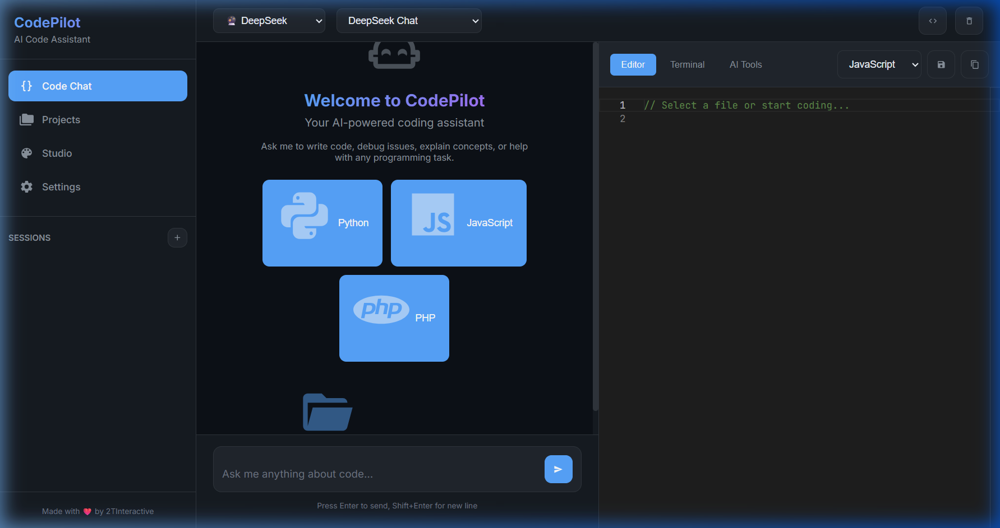
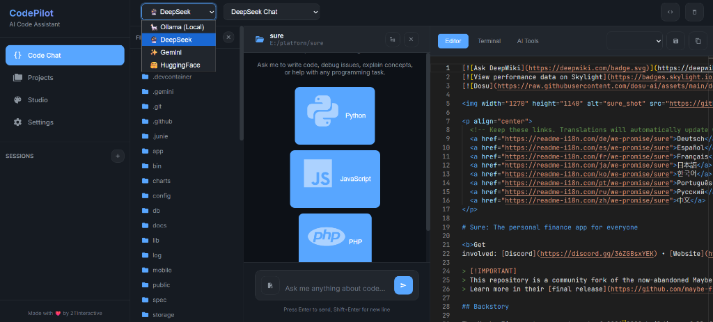
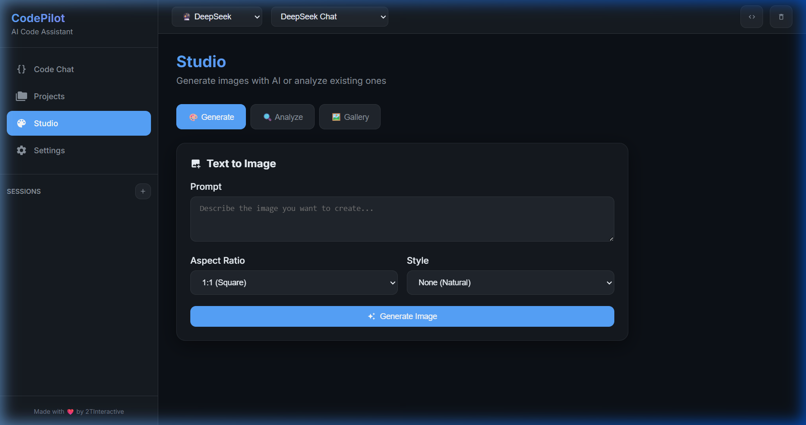
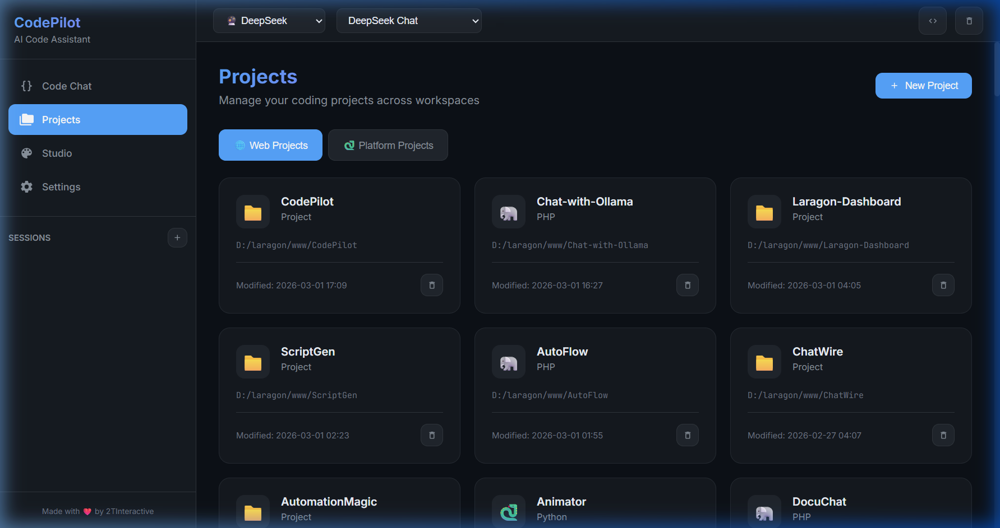

<div align="center">

# 🚀 Nexa Open AI

### مساعد ذكاء اصطناعي للبرمجة والدردشة — يعمل مجاناً وبدون إنترنت
### Free AI Coding Assistant & Chat — Works Offline

[](LICENSE)
[](https://php.net)
[](https://ollama.com)

**منصة ويب متكاملة للدردشة مع الذكاء الاصطناعي، كتابة وتعديل الأكواد، إدارة المشاريع البرمجية، وتوليد وتحليل الصور.**

[المميزات](#-المميزات--features) • [التثبيت](#-طريقة-التثبيت--installation) • [Ollama](#-الخطوة-2-تثبيت-ollama) • [API](#-الحصول-على-مفاتيح-api) • [الدعم](#-للمساعدة-والدعم--support)

</div>

---

## ✨ المميزات / Features

| الميزة | الوصف |
|--------|-------|
| 💬 **الدردشة الذكية** | تحدث مع نماذج الذكاء الاصطناعي في أي موضوع |
| 👨‍💻 **كتابة الأكواد** | اكتب واشرح وصحح الأكواد بمختلف لغات البرمجة |
| 🛠️ **تعديل الملفات البرمجية** | تصفح وعدّل واحفظ ملفات مشروعك مباشرة |
| 📁 **إدارة المشاريع** | أنشئ مشاريع جاهزة بعدة لغات (PHP, Python, Node.js, HTML, Flask, Express) |
| 🌐 **المواقع والتطبيقات** | ساعدك الذكاء الاصطناعي في تصميم وبرمجة المواقع والتطبيقات |
| 🎨 **استوديو الصور** | توليد الصور وتحليلها بالذكاء الاصطناعي |
| 📝 **محرر Monaco** | نفس محرر VS Code داخل المتصفح |
| 🔌 **عدة مزودين** | Ollama (محلي)، DeepSeek، Gemini، HuggingFace |
| 📴 **يعمل بدون إنترنت** | عند استخدام نماذج Ollama المحلية |
| 🌙 **تصميم داكن** | واجهة عصرية بتأثير الزجاج (Glassmorphism) |

> 💡 **ملاحظة:** وضع "بدون إنترنت" يعمل مع نماذج **Ollama المحلية** فقط. أما DeepSeek وGemini وHuggingFace فهي خدمات سحابية تحتاج اتصالاً بالإنترنت ومفتاح API.

---

## 🖼️ لقطات الشاشة / Screenshots

<div align="center">

| الدردشة | محرر الأكواد | الاستوديو | المشاريع |
|---------|-------------|-----------|----------|
|  |  |  |  |

</div>

---

## 💻 المتطلبات / Requirements

| المتطلب | التفاصيل |
|---------|----------|
| PHP | 8.1 أو أحدث |
| الخادم | Apache مع mod_rewrite (XAMPP أو Laragon أو WAMP) |
| Ollama | لتشغيل النماذج محلياً |
| الجهاز | **حاسوب بمواصفات عالية** لأداء أفضل (انظر أدناه) |

### ⚡ المواصفات الموصى بها

لتعمل النماذج بصورة أفضل يُفضّل حاسوب قوي:

| المستوى | RAM | ملاحظات |
|---------|-----|---------|
| أدنى | 8 GB | نماذج صغيرة فقط (1B–3B) |
| جيد | 16 GB | نماذج متوسطة (7B–8B) |
| ممتاز | 32 GB+ وكرت شاشة GPU | نماذج كبيرة وأسرع بكثير |

> ⚠️ **تنبيه:** تحميل النماذج يستهلك **إنترنت** (من بضع مئات MB إلى عدة GB لكل نموذج). تحتاج الإنترنت مرة واحدة فقط للتحميل، وبعدها يعمل النموذج بدون اتصال.

---

## 🚀 طريقة التثبيت / Installation

### 📥 الخطوة 1: تحميل المشروع

حمّل المشروع من موقع **سيما سوفت (Simasoft)**:

🔗 **https://simasoft.site**

ثم:
1. فك ضغط الملف
2. انقل المجلد إلى مجلد الخادم:
   - XAMPP: `C:\xampp\htdocs\`
   - Laragon: `C:\laragon\www\`

### 🦙 الخطوة 2: تثبيت Ollama

لتشغيل المشروع يجب تحميل وتثبيت تطبيق **Ollama**:

🔗 **رابط التحميل:** https://ollama.com/download

متوفر لـ Windows وmacOS وLinux.

بعد التثبيت، تأكد أنه يعمل بفتح الطرفية (Terminal / CMD) وكتابة:

```bash
ollama --version
```

### 🤖 الخطوة 3: تحميل نماذج الذكاء الاصطناعي

تصفح كل النماذج المتاحة من هنا: https://ollama.com/library

ثم حمّل النموذج الذي تريده، أمثلة:

```bash
# نموذج عام للدردشة (خفيف)
ollama pull llama3.2

# نموذج متخصص في البرمجة
ollama pull qwen2.5-coder:7b

# نموذج DeepSeek للبرمجة
ollama pull deepseek-coder

# عرض النماذج المثبتة عندك
ollama list
```

للتجربة السريعة من الطرفية:

```bash
ollama run llama3.2
```

> 💡 اختر النموذج حسب مواصفات جهازك. النماذج الأصغر أسرع وتعمل على أجهزة أضعف.

### ⚙️ الخطوة 4: إعداد المشروع

انسخ ملف الإعدادات:

```bash
cp .env.example .env
```

(على ويندوز: انسخ `.env.example` وسمّه `.env`)

ثم عدّل ملف `.env`:

```env
# Ollama (محلي - لا يحتاج مفتاح ولا إنترنت)
OLLAMA_API_URL=http://localhost:11434/api

# DeepSeek (اختياري - يحتاج إنترنت)
DEEPSEEK_API_KEY=your_key_here

# Google Gemini (اختياري - يحتاج إنترنت)
GEMINI_API_KEY=your_key_here

# HuggingFace (اختياري - يحتاج إنترنت)
HUGGINGFACE_API_KEY=your_key_here
```

> للعمل بدون إنترنت يكفيك إعداد `OLLAMA_API_URL` فقط.

### 🌐 الخطوة 5: التشغيل

1. شغّل **Ollama** (يعمل تلقائياً في الخلفية بعد التثبيت)
2. شغّل **Apache** من XAMPP أو Laragon
3. افتح المتصفح:

```text
http://localhost/NexaOpenAI/public/
```

> 📝 غيّر `NexaOpenAI` إلى اسم مجلد المشروع عندك.

---

## 🔑 الحصول على مفاتيح API

لتشغيل النماذج السحابية (اختياري) تحتاج مفتاح API من كل مزود:

| المزود | رابط الحصول على المفتاح | النماذج |
|--------|--------------------------|---------|
| **DeepSeek** | https://platform.deepseek.com/api_keys | Chat, Coder, Reasoner (R1) |
| **Google Gemini** | https://aistudio.google.com/app/apikey | Gemini 2.5 Pro / Flash |
| **HuggingFace** | https://huggingface.co/settings/tokens | Llama, Qwen, Mixtral |

### طريقة الحصول على المفتاح:
1. ادخل على رابط المزود وسجّل حساباً (أو سجّل الدخول)
2. اضغط **Create API Key** (إنشاء مفتاح)
3. انسخ المفتاح فوراً (قد لا يظهر مرة أخرى)
4. الصقه في ملف `.env` مكان `your_key_here`

> 🔒 **لا تشارك مفاتيح API مع أحد ولا ترفعها على GitHub.** وأضف `.env` إلى ملف `.gitignore`.

---

## 📦 قوالب المشاريع / Project Templates

| القالب | الوصف |
|--------|-------|
| 🐘 **PHP** | مشروع Composer جاهز |
| 🐍 **Python** | مشروع Python حديث مع pytest |
| 📦 **Node.js** | حزمة ESM مع اختبارات |
| 🌐 **HTML** | صفحة هبوط جاهزة ومتجاوبة |
| 🧪 **Flask** | تطبيق ويب بـ Python |
| ⚡ **Express** | واجهة REST API بـ Node.js |

---

## 🎨 استوديو الصور / AI Studio

### توليد الصور
- أبعاد متعددة (1:1, 16:9, 9:16)
- أنماط جاهزة (واقعي، فن رقمي، أنمي، وغيرها)
- حفظ تلقائي في المعرض

### تحليل الصور
ارفع صورة ودع الذكاء الاصطناعي يحللها:
- تصحيح أخطاء من لقطات شاشة الأكواد
- تحليل تصاميم الواجهات
- تفسير المخططات
- شرح رسائل الأخطاء

> ℹ️ توليد وتحليل الصور يعتمدان على مزودين سحابيين (مثل Gemini) ويحتاجان إنترنت ومفتاح API.

---

## 🔌 نقاط الـ API / API Endpoints

| المسار | الطريقة | الوصف |
|--------|---------|-------|
| `/api/chat.php` | POST | الدردشة متعددة المزودين |
| `/api/vision.php` | POST | تحليل الصور |
| `/api/imagen.php` | POST | توليد الصور |
| `/api/projects.php` | GET/POST | إدارة المشاريع |
| `/api/files.php` | GET/POST | عمليات الملفات |
| `/api/providers.php` | GET | قائمة النماذج المتاحة |

---

## 🗂️ هيكل المشروع / Project Structure

```text
NexaOpenAI/
├── public/
│   ├── index.php          # واجهة الدردشة
│   ├── projects.php       # مدير المشاريع
│   ├── studio.php         # استوديو الصور
│   ├── settings.php       # الإعدادات
│   ├── api/               # نقاط الـ API
│   ├── assets/            # CSS & JS
│   └── generated/         # الصور المولّدة
├── src/
│   └── config.php         # محمّل الإعدادات
├── .env                   # متغيرات البيئة
└── README.md
```

---

## 🛠️ المزودون المدعومون / Supported Providers

| المزود | النماذج | النوع |
|--------|---------|-------|
| **Ollama** | أي نموذج محلي | 🟢 محلي (بدون إنترنت) |
| **DeepSeek** | Chat, Coder, Reasoner (R1) | ☁️ سحابي |
| **Gemini** | 2.5 Pro, 2.5 Flash, 2.0, 1.5 | ☁️ سحابي |
| **HuggingFace** | Llama 3.3, Qwen 2.5, Mixtral | ☁️ سحابي |

---

## 🧰 حل المشاكل / Troubleshooting

| المشكلة | الحل |
|---------|------|
| لا ترد النماذج | تأكد أن Ollama يعمل وأنك حمّلت نموذجاً (`ollama list`) |
| النموذج بطيء جداً | استخدم نموذجاً أصغر أو جهازاً بذاكرة RAM وGPU أقوى |
| خطأ اتصال بـ Ollama | تأكد أن `OLLAMA_API_URL=http://localhost:11434/api` صحيح |
| صفحة بيضاء | تأكد أن PHP 8.1+ وأن Apache يعمل |
| النماذج السحابية لا تعمل | تحقق من مفتاح API ومن اتصال الإنترنت |

---

## 📞 للمساعدة والدعم / Support

لأي مشكلة أو استفسار أو طلب إضافات، تواصل معنا:

- 📧 **Email:** aliexsandstone@gmail.com
- 💬 **WhatsApp:** +249124302466
- 📘 **Facebook:** [abbasawad26](https://facebook.com/abbasawad26)
- 🌐 **تحميل المشروع:** https://simasoft.site

---

## 👨‍💻 المطور / Developer

**Abbas Awad (عباس عوض)**

---

## 📄 الترخيص والشكر / License & Credits

هذا المشروع مرخّص بموجب رخصة **MIT** — راجع ملف [LICENSE](LICENSE).

🙏 المشروع مبني على المشروع مفتوح المصدر **CodePilot** للمطور Tarek Tarabichi ([@LebToki](https://github.com/LebToki/CodePilot))، وتم تطويره وتعديله بواسطة Abbas Awad. يُرجى الإبقاء على إشعار حقوق النشر الأصلي في ملف `LICENSE`.

---

<div align="center">

**Nexa Open AI — تطوير عباس عوض**

⭐ إذا أعجبك المشروع لا تنسَ دعمه!

</div>
